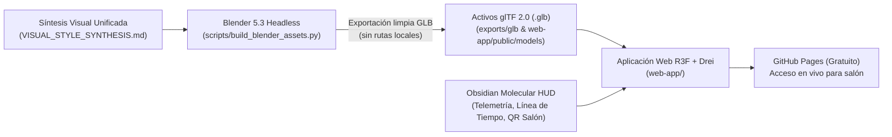

# Arquitectura Inicial — Nanomedicine Editorial Lab

## 1. Visión General del Sistema

**Nanomedicine Editorial Lab** desacopla la creación procedural de activos científicos 3D de alta fidelidad (en **Blender 5.3** vía `scripts/build_blender_assets.py`) de la experiencia interactiva en tiempo real (en **React + TypeScript + Three.js / React Three Fiber**).



---

## 2. Pipeline Blender → GLB → WebGL

1. **Generación Modular (`scripts/build_blender_assets.py`):**
   * Construye en Blender 5.3 los activos modulares por componente (`agnp_core.glb`, `rosemary_corona.glb`, `folate_ligands.glb`, `nanocellulose_matrix.glb`, `tumor_microenv.glb`, `receptor_fra.glb`, `clathrin_cage.glb`, `mitochondrion_editorial.glb`, `apoptosome_cell.glb`).
   * Guarda versiones `.blend` locales en `Blender/models/` sin modificar la escena base `Blender/scenes/set00_base.blend`.
2. **Unificación de Materiales en Runtime:**
   * Al cargar los modelos `.glb` en React Three Fiber, se aplican las **5 Familias Maestras de Materiales** (`src/materials/editorialMaterials.ts`) bajo un único entorno de estudio PMREM de 3 *softboxes*, garantizando coherencia cromática, de rugosidad y de corte 3/4 en los **9 Sets**.

---

## 3. Arquitectura de la Aplicación Web (`web-app/`)

Construida sobre **React 19 + TypeScript + Vite 8 + Three.js + `@react-three/fiber` + `@react-three/drei`**.

```text
web-app/
├── public/models/                   # Activos .glb optimizados servidos estáticamente
└── src/
    ├── types/simulation.ts          # Tipos para los 9 sets, variantes, moléculas y telemetría
    ├── config/setsData.ts           # Datos científicos, cámaras y enciclopedia molecular (Set 00–08)
    ├── materials/editorialMaterials.ts # Paleta Obsidian HUD, 5 familias PBR y entorno PMREM
    ├── components/
    │   ├── canvas/
    │   │   ├── EditorialViewport.tsx # Canvas R3F, iluminación Set 00, controles orbitales y tooltip
    │   │   └── SetScenes.tsx        # Escenas 3D animadas e interactivas para Set 00 a Set 08
    │   └── hud/
    │       ├── ObsidianHud.tsx      # Header, paneles laterales/móviles, línea de tiempo 00–08
    │       └── QRModal.tsx          # Generador QR offline en navegador para compartir en clase
    ├── App.tsx
    └── main.tsx
```

---

## 4. Sistema Visual: *Scientific Editorial* + *Obsidian Molecular HUD*

* **Lienzo WebGL:** Obsidian Void (`#07090e` → `#0e1726`).
* **Paneles HUD:** Slate Charcoal translúcido (`rgba(13, 17, 23, 0.78)`) con `backdrop-filter: blur(16px)` y bordes `1px` (`rgba(148, 163, 184, 0.14)`).
* **Paleta Bioquímica Desaturada:**
  * **Plata / `Ag⁺`:** `#5e8b94` / `#a0ced8`
  * **Especies Reactivas `ROS`:** `#b4823e` / `#f6bc72`
  * **Glutatión `GSH` / Homeostasis:** `#6b8f71` / `#aad0ae`
  * **Citocromo c / Apoptosis:** `#7c3f58` / `#c084fc`
* **Tipografía:** `Inter` + `JetBrains Mono` (tabular-nums).
