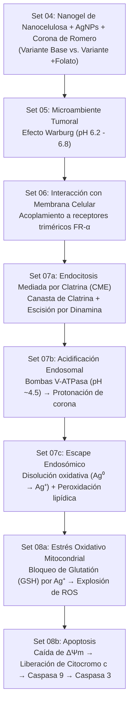

# Directrices Científicas y Mecanismo Propuesto

## 1. Principios de Rigor y Transparencia Científica

1. **Separación entre arquitectura del material y mecanismo biológico propuesto:**
   * **Sets 01–04 (Arquitectura del Material):** Representan la estructura física conceptual del nanogel de nanocelulosa con AgNPs y corona fitoquímica de *Rosmarinus officinalis* (y su variante con ligandos de Ácido Fólico).
   * **Sets 05–08 (Microambiente y Cascada Intracelular):** Representan el microambiente fisiopatológico y un **mecanismo de acción propuesto** en nanomedicina oncológica. En la interfaz web se identifica explícitamente como `MECANISMO PROPUESTO / SIMULACIÓN CONCEPTUAL`.
2. **No invención de datos experimentales:**
   * Los parámetros dinámicos del HUD (`pH`, `ΔΨm`, `% GSH`, `% ROS`, `% Ag⁺`) son variables conceptuales normalizadas o rangos fisiológicos de referencia (ej. `pH 7.4` fisiológico, `pH 6.2–6.8` intersticio tumoral Warburg, `pH ~4.5` lumen endosomal) hasta incorporar datos experimentales propios.

---

## 2. Secuencia Bioquímica del Mecanismo Propuesto (`Sets 05–08`)

